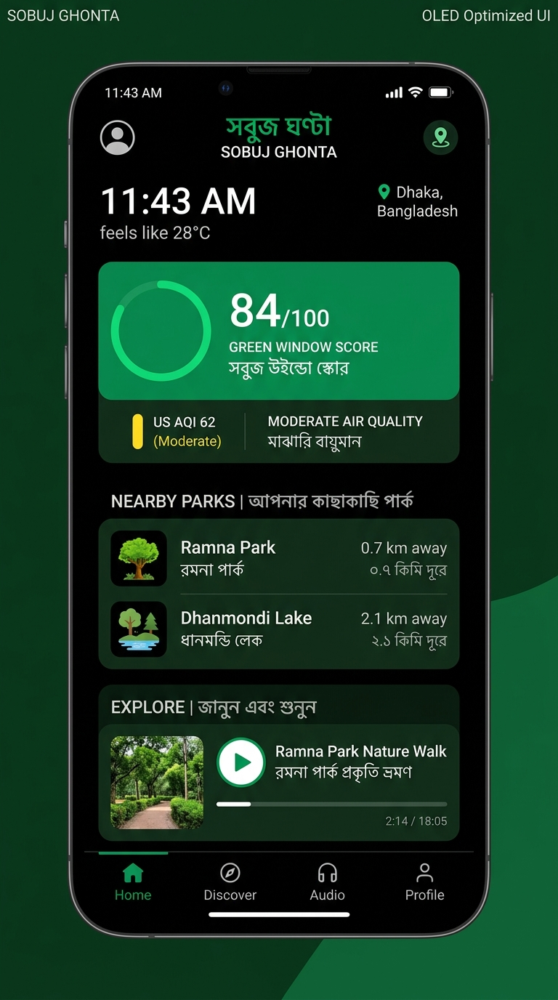
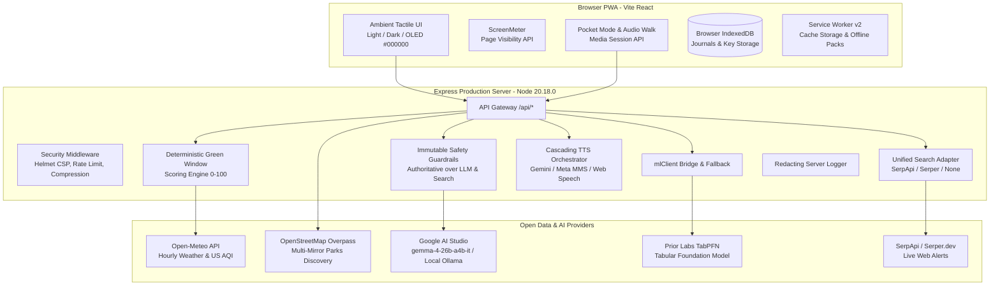

# Sobuj Ghonta (সবুজ ঘণ্টা) — The Green Hour

> **Ambient, screen-minimizing outdoor companion for safe urban nature discovery.**  
> Built for the [DEV Hacktoberfest Open-Source AI Challenge Week 1: Touch Grass](https://dev.to/challenges/hacktoberfest-week1-2026-10-05).

[](LICENSE)
[](https://nodejs.org/)
[](https://sobujghonta.onrender.com/)
[](TEST_READY.md)


---

## 🌿 What is Sobuj Ghonta?

For over four billion people living in dense urban centers, "touching grass" is not a 10-minute drive to pristine mountain trails. In high-density megacities like Dhaka, Delhi, or São Paulo, nature exists in fragmented municipal parks, lakeside paths, and pocket gardens nestled among flyovers and traffic.

Stepping outside in these environments requires navigating **harsh environmental realities**:
1. **Severe Air Pollution:** US AQI frequently spikes above 150 (Unhealthy) or 200 (Very Unhealthy), turning cardiovascular exertion into a pulmonary health risk.
2. **Urban Heat Islands:** Apparent temperatures exceed 38°C midday, creating acute heat-stroke risks.
3. **Monsoon Humidity & Dengue Risks:** Stagnant water and post-rain humidity (>70%) trigger mosquito breeding seasons.

Worse yet, conventional navigation and fitness apps create a glaring paradox: **to experience nature, they force you to stay glued to a glowing glass screen.**

**Sobuj Ghonta (সবুজ ঘণ্টা — "The Green Hour")** flips this paradigm with a singular architectural mandate: **find your safe green window, get you outside safely, and get out of your way.**

- **Live Application:** [https://sobujghonta.onrender.com/](https://sobujghonta.onrender.com/)
- **Zero-Key Instant Demo:** Tap **"Demo (Offline)"** in the header to evaluate all features with 0 API keys and 0 external network requests across 8 global cities.

---

## 📱 Interface Preview



---

## 🏗️ Architecture Diagram



---

## ✨ Verified Core Features

### 1. Deterministic Green Window Scoring Engine (0–100)
Evaluates real-time Open-Meteo hourly telemetry across US AQI, PM2.5, apparent temperature, UV radiation, precipitation probability, and solar sunset times. Mathematical formulas penalize pollution and heat while awarding golden-hour bonuses.

### 2. Immutable Code Guardrails That AI Cannot Override
Public health rules in `server/services/guardrails.js` strictly sanitize and validate LLM outputs:
- **AQI > 150:** Forces walk effort level to `gentle`.
- **AQI > 200:** Barred from outdoor exertion (`rest`); mandates N95/FFP2 mask guidance.
- **Apparent Temp ≥ 38°C:** Enforces extreme heat hydration protocols.
- **Thunderstorms (WMO 95, 96, 99):** Collapses score to 0 and orders immediate indoor shelter.

### 3. Prior Labs TabPFN Tabular Foundation Model Integration
- **24–72h Quantile Uncertainty Bands:** Forecasts PM2.5, US AQI, apparent temperature, and UV with nominal 80% intervals $[p_{10}, p_{90}]$.
- **Anomaly Detection:** Flags statistical residual spikes ("Unusually smoky or hot for this hour") and surfaces concise spoken warnings only when safety-relevant.
- **Tri-State Fallback Parity:** If the Python ML sidecar (`ml/app.py`) is offline or constrained on Render's 512MB free tier, `mlClient.js` transparently cascades to a high-fidelity deterministic baseline labeled `"baseline (not TabPFN)"`.
- **Personal Green Hour Log:** On-device regression predicting optimal walk hours from personal walk logs with RFC 4180 CSV import and export.

### 4. Unified Live Web Search Adapter (SerpApi + Serper)
- **Screen-Minimizing Delivery:** Extracts at most **ONE concise line** for UI and spoken audio (park closures, maintenance, or official air/weather advisories).
- **Prompt Injection Defense:** Strips HTML, caps length at 200 chars, neutralizes `javascript:` / `data:` pseudo-URLs, and never executes instructions found inside search snippets.
- **In-Memory Cache & Quotas:** 45-minute LRU cache with 2-decimal rounded coordinates to protect user location privacy.

### 5. Cascading Multi-Tier Free TTS Provider Chain
Delivers mindful audio guidance across English and Bengali (`bn-BD`):
1. **Gemini 3.8 Flash TTS (`gemini-3.8-flash-tts`):** Reuses the existing Google AI Studio key (`GEMMA_API_KEY`). Studio-quality 24 kHz audio.
2. **Meta MMS-TTS (`facebook/mms-tts-ben` & `eng`):** Open-weight speech models via Hugging Face Serverless Inference (`HF_TOKEN`).
3. **Browser Web Speech API:** Client-side zero-cloud fallback with automated Bengali voice detection.
4. **Bundled Dhaka Audio Clips:** 8 pre-generated WAV clips committed in the repository for 0 ms latency offline walks.

### 6. Ambient Tactile UI & OLED Pocket Mode
- **Three Themes:** Light, Dark, and OLED Pure Black (`#000000`).
- **Tactile Accessibility:** Minimum 44×44px hit targets, full keyboard accessibility, RTL layout support for Arabic (`[dir="rtl"]`).
- **ScreenMeter Hero Metric:** Uses Page Visibility API to calculate screen time vs. outdoor walking time.
- **Canvas Walk Receipt:** Renders a downloadable tactile share card celebrating low-screen outdoor ratio.

---

## ⚡ Zero-Key Instant Demo: 8 Bundled Global City Packs

You do **not** need an API key to evaluate Sobuj Ghonta:
- **Cities Supported:** Dhaka, Delhi, London, Los Angeles, Nairobi, São Paulo, Sydney, and Tokyo.
- Real dated telemetry snapshots, OSM green spaces, TabPFN quantile bands, and search heads-up advisories.
- Operates with **0 API keys** and **0 external network requests**.

---

## 🔒 Three Zero-Leak Secret Paths & Privacy Model

To ensure keys are never exposed in logs, commits, or community posts:
1. **Terminal CLI Setup:** `npm run setup:keys` prompts for keys with masked input (`*`), validates formatting, and writes to `.env` with restrictive `0600` permissions.
2. **In-App Keys & Providers Panel:** Settings > Keys & Providers uses password fields with visibility toggles, format validation, and ephemeral `sessionStorage` by default (with optional opt-in to browser `IndexedDB`). Sent to backend exclusively via HTTPS request headers (`x-gemma-key`, `x-tabpfn-key`, etc.).
3. **Automated Redacting Logger & Secret Scanner:** `server/services/logger.js` automatically strips Google, ElevenLabs, Hugging Face, SerpApi, and TabPFN tokens from server output. `npm run scan:secrets` scans all files before commits.

### Privacy Guarantees
- Coordinates are rounded to 2 decimal places (~1.1 km) before passing to any third-party weather or search API.
- Personal Nature Journal photos and walk notes remain strictly inside on-device **IndexedDB**; photos are never stored on remote servers.

---

## ⚙️ Environment Variables

| Variable | Required | Default | Description |
| :--- | :---: | :---: | :--- |
| `PORT` | No | `10000` | HTTP port for Express web server |
| `NODE_ENV` | No | `development` | Environment mode (`production`, `development`, `test`) |
| `LLM_PROVIDER` | No | `gemma_api` | LLM reasoning engine: `gemma_api`, `ollama`, or `mock` |
| `GEMMA_API_KEY` | Optional | — | Google AI Studio API key for Gemma and Gemini TTS |
| `GEMMA_MODEL` | No | `gemma-4-26b-a4b-it` | Google AI Studio model identifier |
| `OLLAMA_URL` | No | `http://localhost:11434` | Local Ollama endpoint |
| `OLLAMA_MODEL` | No | `gemma2:9b` | Local Ollama model tag |
| `TTS_PROVIDER` | No | `auto` | TTS mode: `auto`, `gemini`, `mms`, `browser`, `none` |
| `HF_TOKEN` | Optional | — | Hugging Face token for Meta MMS-TTS inference |
| `TABPFN_MODE` | No | `auto` | TabPFN execution mode: `auto`, `local`, `client`, `off` |
| `TABPFN_TOKEN` | Optional | — | Prior Labs Client API token (from https://cloud.priorlabs.ai) |
| `SEARCH_PROVIDER`| No | `serpapi` | Search engine provider: `serpapi`, `serper`, `none` |
| `SERPAPI_API_KEY`| Optional | — | SerpApi Google Search engine API key |
| `SERPER_API_KEY` | Optional | — | Serper.dev Google Search API key |

---

## 💻 Local Setup & Development

### Prerequisites
- Node.js >= 20.0.0 (Pinned to `20.18.0`)
- npm >= 10.0.0

### Quickstart
```bash
# 1. Clone repository
git clone https://github.com/SayemR0018/sobujGhonta.git
cd sobujGhonta

# 2. Install dependencies (server + client workspace)
npm install

# 3. Configure environment keys interactively
npm run setup:keys

# 4. Verify 0 leaked secrets
npm run scan:secrets

# 5. Build frontend client
npm run build

# 6. Start production server
npm start
```
Open [http://localhost:10000](http://localhost:10000) in your browser.

### 🦙 Running 100% Offline with Local Ollama
```bash
# Pull open weights locally
ollama pull gemma2:9b

# Set environment
export LLM_PROVIDER=ollama
export OLLAMA_MODEL=gemma2:9b
export TTS_PROVIDER=browser
export SEARCH_PROVIDER=none
export TABPFN_MODE=off

npm start
```

---

## 🧪 Verification & Testing Commands

| Command | Scope | Pass Rate |
| :--- | :--- | :---: |
| `npm test` | 79 unit and contract tests across 12 test suites | **79 / 79 (100%)** |
| `npm run test:e2e` | 390 E2E tests across 78 suites (Tiers 1–4) | **390 / 390 (100%)** |
| `npm run smoke` | 9 production deployment smoke checks | **9 / 9 (100%)** |
| `node scripts/fullQaRunner.mjs` | 16 production integration checks | **16 / 16 (100%)** |
| `npm run backtest` | 48-hour held-out empirical backtest for TabPFN | **Pass (3 cities)** |
| `npm run scan:secrets` | Secret scanning across workspace and docs | **0 leaks** |

---

## 🚀 Deploying to Render

Deploy with the declarative Blueprint (`render.yaml`):

1. Fork or push this repository to your GitHub account.
2. In the [Render Dashboard](https://dashboard.render.com/), navigate to **New +** → **Blueprint**.
3. Select your repository `sobujGhonta`.
4. Render detects `render.yaml` and sets up the web service:
   - **Runtime:** Node.js `20.18.0`
   - **Build Command:** `npm install && npm run build`
   - **Start Command:** `node server/index.js`
   - **Health Check:** `/health`
5. (Optional) Set secret environment variables (`GEMMA_API_KEY`, `TABPFN_TOKEN`, `SERPAPI_API_KEY`) in the Render environment dashboard. The app boots immediately in zero-key mode if none are set.

---

## 📄 Licenses & NOTICE

This project is licensed under the [MIT License](LICENSE) — Copyright (c) 2026 Sayem Rahman.

Third-party models and open datasets:
- **Prior Labs TabPFN:** Developed by Prior Labs GmbH (TabPFN-v2). Used under research/evaluation license terms. See [NOTICE](NOTICE) and [docs/TABPFN_EVAL.md](docs/TABPFN_EVAL.md).
- **Google Gemma:** Google open weights governed by the Gemma Terms of Use.
- **Meta MMS-TTS:** CC-BY-NC 4.0 (Meta AI).
- **Open-Meteo:** CC BY 4.0 (Free Weather & Air Quality API).
- **OpenStreetMap:** Open Database License (ODbL 1.0).
- **Typography:** Noto Sans Bengali & Inter (Google Fonts, SIL Open Font License).

---

## 📅 Challenge Compliance Note

Built for the **DEV Hacktoberfest Open-Source AI Challenge Week 1: Touch Grass** (October 5 – October 11, 2026).  
All primary feature engineering, empirical evaluations, and documentation were completed within the challenge window prior to the deadline: **October 11, 2026, 11:59 PM PDT**. Any post-deadline commits are restricted to dependency maintenance or environment configuration adjustments and will be itemized here.